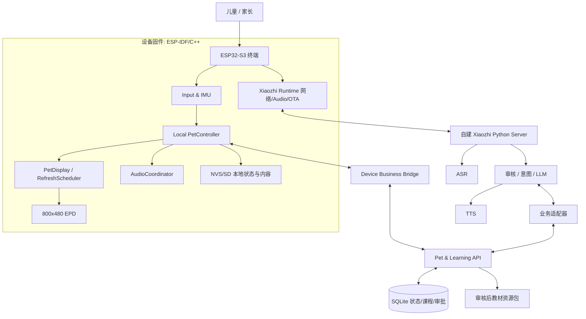

# 技术架构设计

状态：设计草案 v0.1 ｜ 目标硬件：Waveshare ESP32-S3-ePaper-3.97

## 1. 设计边界

**三层解耦**：ESP32 上的小智运行时负责硬件与通信；自建小智 Python 服务端负责语音转写、模型与合成；独立 Pet/Learning 服务负责长期业务。默认采用“本地确定性事件 + 可选云端智能”原则，避免把长时宠物状态和 UI 控制塞进大模型提示词。



正式接口需要在 P3 验证并与自建服务端的实际生命周期挂接。图示表达逻辑数据流，不代表当前开源代码已经实现所有方框。

## 2. 组件职责与依赖禁止规则

| 组件 | 主要责任 | 不应该负责 |
|---|---|---|
| Xiaozhi Runtime | 音频采集/编解码、连接、OTA、设备语音状态 | 宠物成长、课程持久化 |
| BoardAdapter | 初始化板载音频/电源/屏幕/按键，接入 IMU/SD | 宠物业务规则 |
| PetController | 状态机、离线互动、场景选择、业务事件 | I2S/SPI 底层、直接使用 LLM |
| SceneComposer | 按宠物状态生成屏幕场景 | 根据每个 ASR 片段刷新 |
| RefreshScheduler | 脏区合并、刷新节流、残影恢复、BUSY 管理 | 宠物成长决策 |
| InputManager | 物理键/IMU 去抖、手势和动作识别 | 直接赋积分 |
| AudioCoordinator | 唯一音频播放仲裁器；暂停/打断/恢复 | 内容审核 |
| ContentPlayer | 本地已审核资源包、分页和故事播放进度 | 生成未审核故事 |
| DeviceBridge | 业务事件同步、命令确认、恢复队列 | 存储孩子敏感录音 |
| VoiceAdapter | ASR/意图、安全门控/LLM/TTS 与业务 API 的对接 | 宠物长期数据归属 |
| PetLearning API | 状态持久化、进度、规则、资源审批、家长设置 | 具体像素与音频外设操作 |

**依赖方向**：
- `PetController -> (abstract) DisplayPort, AudioPort, StoragePort, EventPort`。
- `BoardAdapter` 提供这些 Port 的 ESP32 实现；不要让 PetEngine 直接 `#include` 小智内部 `Application`。
- `VoiceAdapter -> PetLearning API`，语音服务不直接写业务数据库。
- 设备端任何 UI/音频调用都通过相应线程/消息队列，禁止后台业务线程绕开显示锁。

## 3. 设备端建议结构

```text
firmware/
  components/kid_app/
    include/kid_app/
      event.h
      pet_state.h
      pet_controller.h
      display_port.h
      audio_port.h
      storage_port.h
    src/
      pet_controller.cc
      input_manager.cc
      imu_gestures.cc
      scene_composer.cc
      refresh_scheduler.cc
      content_player.cc
      audio_coordinator.cc
      device_bridge.cc
      storage_nvs.cc
  integration/
    xiaozhi_hooks.cc
    waveshare_board_adapter.cc
```

这是设计目标；最终构建集成方式由 ADR-007（P0）确定。提供开发时纯 C++ 的宠物状态机模拟入口，便于无硬件单元测试。

### 3.1 PetController（核心有限状态机）

建议分离两个维度，避免状态爆炸：

- **运行状态**：`IDLE | PET_INTERACT | STORY_PLAYING | AI_LISTENING | AI_SPEAKING | QUIET | SLEEP`
- **宠物表情**：`NEUTRAL | HAPPY | CURIOUS | SURPRISED | THINKING | SLEEPY | CONFUSED`
- **活动场景**：`HOME | FEED | GAME | READER | CHAT | PARENT`

事件 `PetEvent` 走**串行队列**，带 `event_id`、`source`、`created_at`、`kind`、`payload`。同一事件必须至多一次生效（同步操作幂等）。状态改变发布 `SceneChanged` 和 `AudioAction`，而不是直接在语音回调中作 SPI 刷新。

状态规则举例：

| 当前状态 | 事件 | 行为 | 新状态 |
|---|---|---|---|
| IDLE | PICKUP | 轻声提示 + 开心静态表情 | PET_INTERACT |
| PET_INTERACT | PLAY_STORY | 加载审核内容包并播放 | STORY_PLAYING |
| STORY_PLAYING | ASK_QUESTION | 暂停播放，保存书页进度，启动语音 | AI_LISTENING |
| AI_LISTENING | VOICE_START | 展示“在听”静态画面，保持麦克风 | AI_LISTENING |
| AI_LISTENING | VOICE_TTS_READY | 审核完毕后播放回应 | AI_SPEAKING |
| AI_SPEAKING | VOICE_DONE | 可选恢复故事或回首页 | IDLE / STORY_PLAYING |
| 任意 | QUIET_HOURS_START | 停止联网对话、降低声音，保存状态 | QUIET |
| 任意 | NETWORK_LOST | 取消不可靠云命令、保留本地互动 | 依当前本地活动确定 |

### 3.2 PetDisplay 与墨水屏

官方板卡当前相关源码：
- [waveshare-s3-epaper-3.97.cc](https://github.com/78/xiaozhi-esp32/blob/main/main/boards/waveshare/esp32-s3-epaper-3.97/waveshare-s3-epaper-3.97.cc)
- [custom_lcd_display.cc](https://github.com/78/xiaozhi-esp32/blob/main/main/boards/waveshare/esp32-s3-epaper-3.97/custom_lcd_display.cc)
- [display.h](https://github.com/78/xiaozhi-esp32/blob/main/main/display/display.h)

实际适配板使用 `CustomEpdDisplay : LcdDisplay`，LVGL Full Render Buffer，8-bit 黑白物理缓冲 48,000B；现有 `lvgl_flush_cb` 每次清除内部缓冲区，再按更新区域写像素，`EPD_DisplayPart()` 实际发送固定 48,000B 缓冲。**因此当前并不是一个已验证的任意局部矩形更新引擎。**

初步工程措施：
1. 固定本地 SceneModel：表情、配件、背景、书页、状态文本；只在变化时请求刷新。
2. `SceneComposer` 将 scene 渲染到**统一的黑白逻辑帧缓冲**，产生脏区并对齐到硬件字节边界（实际驱动验证）。
3. `RefreshScheduler` 串行化刷新，统一 BUSY 等待和超时；如果无法可靠局刷，则先使用受限频率的全屏刷新。
4. 用局部高频区域（脸部）和低频大区域（书页/背景）分开策略；实测鬼影后建立定期全刷策略。
5. 在 UI 层停用流式逐字转写导致的刷新；对话使用固定图标/少量状态切换。
6. LVGL/绘图只由 UI 任务或受控锁保护的上下文执行；避免音频回调阻塞 SPI。

内存提示：单通道 1bpp 物理帧约 48KB；800×480 RGB565 的完整帧约 768KB（目前驱动使用 PSRAM 全屏 LVGL 缓冲），需在 P1 用 heap tracing 验证峰值、碎片和音频竞争；不以标称 8MB PSRAM 代替测量。

### 3.3 音频路径

唯一 AudioCoordinator 负责音频输出，不能由本地故事机与小智 TTS 各自直写编解码器。

建议优先级：
1. 系统安全与明确停止命令；
2. 用户主动发起的语音会话与对话回复；
3. 本地故事；
4. 短提示音（允许丢弃）。

音频状态：`STOPPED / STORY / LISTENING / TTS / SFX / PAUSED`。在开始云端聊天时保存书页和播放点并暂停故事，聊天结束后依当前家长策略恢复；断网及取消场景释放音频资源。输出音量、音频缓冲 underrun、首声延迟需要真机记录。

### 3.4 板载输入与传感器

板级源码目前注册 `boot_button_` 与 `pwr_button_`；不要假设产品描述提到的全部交互均已经驱动。P0 确认实际硬件输入装配；如果没有可用旋转输入，则先以 BOOT 的短按/长按模式完成 MVP，再选择外接按键、旋钮或触摸传感器。IMU 需要先确认型号、驱动、中断以及功耗；拿起、放下/轻晃事件须带阈值、去抖与误报测试，禁止鼓励儿童用力甩动设备。

### 3.5 本地存储

- NVS：设备配置、`pet_id`、schema version、当前宠物状态与短时同步元数据；
- SD：大体量且审核后的图卡/语音/绘本资源包；
- RAM：当前播放游标、事件队列、屏幕双缓冲（是否需要双缓冲由实测决定）；
- 写入：限频、校验、原子快照或 A/B 小记录，避免每个动作都写 Flash。
- 恢复：启动时校验 schema 与 checksum；失败恢复上次有效快照；服务端同步的事件去重键不丢失。

## 4. 自建语音服务器

使用 [xinnan-tech/xiaozhi-esp32-server](https://github.com/xinnan-tech/xiaozhi-esp32-server)，不要在首版重写 WebSocket/Opus 或已存在的 ASR/LLM/TTS 基础设施。

```text
Device Audio -> Xiaozhi Protocol -> ASR ->
  SafetyInput + ContextResolver + DeterministicIntentRouter ->
  [若本地/业务命令可决定: 执行 API]
  [若开放聊天: LLM -> SafetyOutput] ->
  TTS -> Device Audio
```

关键是**确定性命令与普通问答分流**：诸如“下一页、暂停、退出、设置音量”由本地或业务意图识别处理，LLM 只处理无法用固定规则确定的儿童问答。严格审核必须覆盖送入 TTS 的每一段文本；若选择 TTS 低延迟流式输出，需改成审核后分句放行或全句审核后播报，不能一边播一边补救。

具体 hook/回调入口须在 P3 对锁定的自建服务端版本做代码调研，形成兼容层，并以 integration tests 保证错误不漏过。

## 5. 独立 Python Pet/Learning Service

建议使用 FastAPI + SQLite（单机 MVP）。与语音进程可部署在同一宿主，但仓库/模块独立；长期需要可迁移数据库实现。

分层：
- `pet`：状态、动作、奖励、偏好白名单、迁移。
- `learning`：图书/页面/问题、游戏、答题结果、进度。
- `content`：内容草稿、AI 批量生成、人工/规则审批、二进制图片转换及打包。
- `parent`：限时、允许内容、数据删除、开放聊天开关。
- `device`：设备绑定、命令/事件同步、资源版本。
- `ai_adapter`：给语音服务器的只读上下文及安全可执行意图。

**状态所有权**：一个事件的即时生效权在本地 `PetController`；服务端长期数据库持有确认后的持久档案和学习进度。冲突以事件版本、唯一事件 ID 和确定性合并规则解决；不能让 LLM 直接写数据库。

## 6. 连接、安全和升级

- 设备业务链路（HTTPS WebSocket / MQTT）与小智实时音频链路独立。P3 比较连接数、TLS RAM 和掉线恢复代价后选型。
- 设备鉴权使用每台独立凭证，不允许在固件仓库硬编码 API Keys、家庭网络密码或其他凭据。
- 重要命令需要 `command_id`、截止时间、幂等键、确认回执；无法在过期后执行旧指令。
- API schema 与资源格式分别做显式版本控制。
- OTA 是单独能力；先核验 16MB Flash 的分区预算和双分区滚动升级，禁止未验证直接刷写儿童常用设备。
- 上游版本锁定、变更冲突解决和 CI/真机回归见 [测试与上游维护](TEST_AND_UPSTREAM.md)。

## 7. 关于 API 选择

自建 Python 语音服务必须配置 ASR、LLM、TTS 提供方；它们可以是 API，也可以本地部署，无需第一阶段就买 GPU。第一轮以“可靠完整语音闭环”为目标，之后再根据 3–5 岁口音、延迟、隐私和成本选具体模型。

## 8. 核心工程风险

| 风险 | 缓解策略 |
|---|---|
| 墨水屏刷新慢、鬼影、区域错误 | P1 单独技术原型；先保证画面对，再优化局刷 |
| 固件内存/音频争用 | 监控 PSRAM、任务栈和音频 underrun；串行刷新 |
| SD 播放与 TTS 冲突 | 单一 AudioCoordinator，明确抢占和恢复 |
| 幼儿语音识别不可靠 | 真实授权场景测试；提供按键/家长补救 |
| LLM 输出审核漏检 | 输出门控、异常即拒绝开放回答；禁用未审批工具 |
| 状态数据错乱 | 事件 ID + 序列号 + 去重 + 原子存储 + 回放测试 |
| 上游变更冲击本项目 | 分离适配层、固定 tag/commit、受控升级 |
| 家长安全控制不可离线执行 | 设备保存最低保护策略，本地强制执行 |

## 9. 本文尚不能证明的事项

本文仅根据代码结构和硬件资料设计，尚未实机验证：P1 局刷效果、外设枚举、OTA 分区、实际可用控制输入、服务端审核 hook、儿童声音表现和功耗。每一项都列入开发计划，不以“可在 C++ 中实现”冒充“已实现”。
