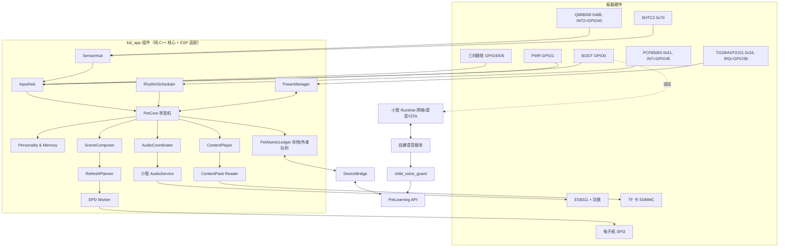

# 技术架构设计

状态：设计 v0.2（按实物硬件重做，2026-11-02）｜目标硬件：Waveshare ESP32-S3-ePaper-3.97

v0.1 只围绕 BOOT/PWR 和电子纸设计。本版加入拨轮、姿态、时钟、温湿度、电源管理、灰度电子纸和麦克风本地能力，并把作息、电源、个性记忆作为一级模块。硬件配置来源见 [硬件基线 §9](hardware/BOARD_BASELINE.md#9-官方资料核对的完整硬件配置2026-11-02)。

## 1. 设计边界

**三层解耦不变**：ESP32 上的小智运行时负责网络、音频编解码、OTA；自建小智 Python 服务端负责 ASR/LLM/TTS；独立 PetLearning 服务负责长期业务数据。**设备端本地优先**：宠物、作息、电源、体感、绘本、游戏全部离线确定性执行，云端只增加语言能力和同步。



## 2. 组件职责

| 组件 | 职责 | 不负责 | 现状 |
|---|---|---|---|
| **InputHub** | 拨轮三向、BOOT、PWR、组合键（家长入口）去抖与语义化；统一产出 `InputEvent` | 业务决策 | 新增；替代按点击次数路由的 `PetInputRouter` |
| **SensorHub** | QMI8658 手势（拿起/轻摇/倾斜/扣下/剧烈摇晃）、SHTC3 读数、麦克风本地音量包络（吹气/拍手） | 存储原始数据 | 新增 |
| **PowerManager** | 电量/充电状态、低电量策略、睡眠/关机流程、唤醒原因、接管小智原版 300 秒自动关机 | 宠物情绪 | 新增 |
| **RhythmScheduler** | 基于 RTC 的作息（起床/午睡/晚上/安静时段）、RTC 闹钟定时开机、联网校时 | 播放内容 | 新增 |
| **PetCore** | 场景/模式/表情状态机、动作条、规则化奖励；所有输入在这里转成幂等 `PetEvent` | I2C/SPI 底层、LLM | 由 `PetController` 扩展 |
| **Personality & Memory** | 性格参数、今日/喜好/成长记忆、话术模板选择 | 自由文本抽取个人信息 | 新增 |
| **PetAtomicLedger** | 宠物快照 + 记忆增量 + 外发事件队列同一事务写 NVS | 大文件 | 已有，需升 schema |
| **SceneComposer** | 由 SceneModel 生成 1-bit 画面 + 脏区列表；灰度页直接走内容包 | 刷新时序 | 已有，需扩展场景/动作条/状态栏 |
| **RefreshPlanner** | 选择局刷/快刷/全刷/灰度刷；局刷计数后强制全刷；与音频互斥窗口协调 | 画什么 | 由 `PetRefreshGate` 扩展 |
| **AudioCoordinator** | 唯一播放仲裁：语音 > 故事 > 选项播报 > 音效；安静时段与音量上限 | 编解码 | 已有，加"选项播报"流 |
| **ContentPlayer / Pack Reader** | 绘本、游戏规则、声音包、装扮图包；CRC 校验、只读 | 审核 | KPB1 已有，扩展为 KPB2 |
| **DeviceBridge** | 事件上报、ACK、记忆同步、策略下发 | 存储录音 | 已有 |
| **child_voice_guard / PetLearning API** | 儿童模式语音全量接管、意图、审核内容、记忆摘要 | 设备动作 | 已有，加个性/记忆接口 |

**依赖规则**：纯 C++ 核心（PetCore、Memory、RhythmScheduler 规则、InputHub 语义层、RefreshPlanner 策略、AudioCoordinator）不 include ESP-IDF 或小智头文件，可主机单测；硬件适配层（GPIO、I2C 驱动、EPD、PMIC、RTC）只提供 Port 实现。

## 3. 设备端结构

```text
firmware/components/kid_app/
  include/kid_app/
    input_hub.h            # InputEvent 语义：DialUp/DialDown/DialPress/DialLong/Talk/SleepReq/ParentCombo
    sensor_hub.h           # Gesture: Pickup/GentleShake/HardShake/Tilt(x,y)/FaceDown/FaceUp; Env; MicEnvelope
    power_manager.h        # BatteryState, WakeReason, ShutdownPlan
    rhythm_scheduler.h     # DayPhase, QuietWindow, NextAlarm
    personality.h          # Trait 参数、话术选择
    memory_store.h         # 今日/喜好/成长记忆，有界、可清空
    pet_controller.h       # 扩展的 PetCore（保持名称，schema 升级）
    scene_model.h          # Home(动作条, 选中项)/Pet/Reader/Game/Chat/Sleep/Parent/Diag
    refresh_planner.h      # 局刷/全刷/灰度策略
    audio_coordinator.h    # + Prompt 流
    content_pack_reader.h  # KPB2（灰度页 + 页内题 + 选项音）
  src/...                  # 纯 C++ 实现
  port/esp/                # GPIO/I2C/SDMMC/EPD/PMIC/RTC 适配（只在固件构建）
scripts/p1_integrate.py    # 小智板卡最薄 overlay：注册拨轮、改 BOOT/PWR 语义、接管省电计时器
```

## 4. 输入：InputHub

### 4.1 物理映射（原理图 + 官方示例 + 2026-11-02 真机核对）

原理图的 Button_Up/Button_Down 是按板子自身方向标的；按孩子推拨轮的方向，V1 第 1 轮试验确认**上 = GPIO6、下 = GPIO4**（[V1 记录](hardware/V1_HARDWARE_ACCEPTANCE.md)）。拨轮中键按住时有触点抖动，InputHub 以 120 ms 释放去抖合并。

| 物理件 | GPIO | 电平 | 语义（儿童模式） |
|---|---|---|---|
| 拨轮上 | 6（原理图标 Button_Down） | 低有效、内部上拉 | `DialUp`：上一个 / 上一页 |
| 拨轮按下 | 5 | 低有效 | `DialPress`：确认；长按 ≥1 s → `DialLong`：回首页 |
| 拨轮下 | 4（原理图标 Button_Up） | 低有效 | `DialDown`：下一个 / 下一页 |
| BOOT | 0 | 低有效 | `Talk`：开始/结束语音（保留小智原语义） |
| PWR | 1（PWR_OUT） | 高有效 | `SleepRequest`：进入睡觉流程（不再直接关机） |
| BOOT + 拨轮按下 5 s | — | — | `ParentCombo`：家长入口 |

官方示例的拨轮用法（上/下切换、按下进入、按下长按全刷）与此一致，可作为驱动参考（multi_button，5 ms 扫描，3 tick 去抖，长按 1 s）。

### 4.2 规则

- 拨轮按住不放时 `DialUp/DialDown` 以 ≤3 次/秒自动重复（只在列表/翻页场景启用），避免幼儿乱拨刷屏。
- 每个 `InputEvent` 先给 AudioCoordinator 一个"咔哒"音效（可丢弃），再由 PetCore 决定动作；因此即使电子纸还在刷，孩子也立即听到反馈。
- 语音进行中，拨轮只允许"取消/回首页"，避免语音与画面打架。
- 输入事件进入现有的单任务队列，不在 GPIO 回调里改状态（沿用 P2 规则）。

## 5. 传感与环境：SensorHub

| 来源 | 处理 | 事件 | 默认 |
|---|---|---|---|
| QMI8658 加速度 | 50–100 Hz 采样，低通 + 阈值 + 持续时间 | `Pickup`（静止→抬起）、`GentleShake`、`HardShake`、`FaceDown`、`FaceUp`、`Tilt(x,y)`（游戏中） | 开；家长可关 |
| QMI8658 INT2（GPIO40） | 运动唤醒中断（浅睡眠用） | `MotionWake` | 待实测 |
| SHTC3 | 每 5 分钟读一次 | `EnvChanged(temp,hum)`（越过阈值才发） | 开 |
| 麦克风 | 游戏内短时开启，只算 RMS 包络，不缓存 PCM | `Blow`、`Clap` | 只在吹气/拍手游戏中 |

- `HardShake` 不给奖励，只触发"团团有点晕，我们轻轻的好吗"。
- GPIO39 在原理图上与姿态 INT1 同标，被功放使能占用；**姿态中断只用 INT2**。
- 麦克风本地包络与小智语音采集共用 I2S 输入，必须在 AudioCoordinator 的"非语音"状态下才开启。

## 6. 电源与作息：PowerManager + RhythmScheduler

### 6.1 电源状态

```text
Active ──(60 s 无操作)──> Idle ──(10 min 无操作 或 安静时段)──> Nap
  ^                         |                                   |
  |<──拨轮/BOOT/拿起─────────┘                                   |
  |<──────────────拨轮/BOOT──────────────────────────────────────┘
Nap ──(30 min 或 PWR 睡觉)──> 画"熟睡"全刷 → 存档 → PMIC 关机（画面保留）
Off ──(PWR 键 或 RTC 闹钟)──> 开机 → 判断唤醒原因 → 早安 / 普通启动
```

| 状态 | CPU | Wi-Fi | 屏幕 | 唤醒源 |
|---|---|---|---|---|
| Active | 运行 | 按需 | 正常刷新 | — |
| Idle | 浅睡眠 | 保持 | 不刷新 | 拨轮、BOOT、PWR、姿态中断 |
| Nap | 浅睡眠 | 关 | 显示"打盹" | 同上 |
| Off | 断电 | 关 | 显示"熟睡"（断电保留） | PWR、RTC 闹钟（经 PMIC 开机） |

- 关机前统一顺序：音频静音 → 刷"熟睡"画面 → 账本提交 → 设置下次 RTC 闹钟 → PMIC 关机。
- 小智原版 `PowerSaveTimer(-1, 100, 300)` 在 300 秒无操作时直接关机，且屏幕显示"OFF"。overlay 须改为由 PowerManager 接管。
- 唤醒原因：开机时读 RTC 闹钟标志（官方示例用 `RTC_INT` 判断）、VBUS 状态区分"闹钟开机 / 按键开机 / 插电开机"。
- ESP32-S3 深睡眠只能用 RTC GPIO（0–21）唤醒；姿态 INT2（40）、RTC INT（45）、PMIC IRQ（38）不在其中，所以采用"浅睡眠 + 真关机"两级，不依赖深睡眠。
- 低电量：<20% 宠物打哈欠并提示找大人充电；<8% 强制走关机顺序。充电中显示"在吃电"。

**V3-03/V3-04 已实现部分**（`kid_app::PowerManager`，板级 pet_input 任务单一所有者）：

- 默认值：60 s 无操作 → Idle；距最后操作 10 min → Nap；Nap 30 min → Off。夜间（Night 时段）与午睡时段：Idle 后立即 Nap；夜间 Nap 5 min 即 Off。语音会话、睡觉流程进行中视为有操作。
- Off 一律走现有睡觉流程（熟睡画面 → 3 s 取消窗 → 下次 RTC 闹钟 → PMIC 关机），不直接关电。
- 只有电池供电（PMIC discharging，与小智原版计时器一致）且本次开机未跑自测脚本时才会因无操作关机；插 USB 时停在 Nap。
- Pet 模式下小智 `PowerSaveTimer` 的 300 s 关机回调只复位计时器；退出 Pet 模式后恢复原行为。
- Idle 目前无画面变化；Nap 显示犯困表情（仅界面，不写账本）并停止眨眼/清残影。CPU 浅睡眠与 Nap 关 Wi-Fi 尚未实现，待 V3-07 实测耗电后再定。
- 早安：RTC 闹钟开机 → 等小智空闲后自动进入 Pet 模式 → 早安画面（太阳在云后、团团伸懒腰，随后太阳升起、团团挥手）→ 60 s 无操作回到睡觉并设第二天闹钟；任意拨轮操作取消，团团保持清醒。90 s 内进不了 Pet 模式（如无网络）则直接画熟睡画面、设闹钟、关机。
- 自测：`morning` 步骤模拟闹钟开机路径（必须先有 `alarm` 步骤）；每次睡觉关机把"是否自测闹钟"写入 PCF85063 RAM 字节（0x03），自测闹钟唤醒后跳过早安关机，便于主机恢复启动分区。

### 6.2 作息

- 时间来源：联网 SNTP 校时后写入 PCF85063；无网时以 RTC 为准；首次未设置时间则作息功能关闭、安静时段按家长在设备上设置的时长执行。
- 家长作息表保存在 NVS（策略版本号）；RhythmScheduler 计算当前 `DayPhase` 与下一次闹钟。
- 定时开机（如起床时间）：开机 → 早安画面 + 轻声问好（安静时段外）→ 1 分钟无互动回到 Off，并设下一次闹钟。

## 7. 显示：SceneComposer + RefreshPlanner

### 7.1 驱动能力（官方 epaper_port）

`EPD_Init / EPD_Init_Fast / EPD_Init_Partial / EPD_Init_4GRAY`、`EPD_Display / EPD_Display_Base / EPD_Display_Fast / EPD_Display_Partial(x0,y0,x1,y1) / EPD_Display_4Gray / EPD_Sleep`。1-bit 帧 48,000 B，4 灰度帧 96,000 B。小智 `CustomEpdDisplay` 只用了其中一部分，需扩展。

### 7.2 刷新策略

| 用途 | 模式 | 区域 | 说明 |
|---|---|---|---|
| 动作条高亮、表情、状态栏 | 1-bit 局刷 | 对应矩形（x 对齐 8 像素） | 最常用 |
| 场景切换 | 1-bit 快刷全屏 | 全屏 | |
| 每 N 次局刷 / 拨轮长按 | 全刷 | 全屏 | 去残影，N 实测定（初值 10） |
| 绘本页、宠物肖像、睡觉画面 | 4 级灰度全刷 | 全屏 | 慢，只用于静态画面 |

- 屏幕布局固定分区：状态栏 800×40、肖像区 800×300、动作条 800×100、提示行 800×40；各区独立脏标记。
- 刷新期间禁止打断：RefreshPlanner 合并排队请求，只保留最新目标画面（沿用场景邮箱）。
- 电子纸刷新与音频不共享总线（SPI3 vs I2S），但刷新 BUSY 等待不得阻塞音频任务。

## 8. 音频：AudioCoordinator

优先级（高→低）：安全停止 > 语音会话（听/说）> 故事朗读 > **选项播报**（新增，可被下一次拨轮打断）> 音效（可丢弃）。

- 选项播报：每个图标/选项对应 TF 声音包中的短音频（如"故事"、"喂食"），拨动时播放，连续拨动只播最后一个。
- 所有设备本地音频通过小智唯一 `AudioService` 输出（P4 已采用的单 I2S 所有者方案）。
- 安静时段：音量降至家长设定的夜间上限；只允许摇篮曲/睡前故事。
- 麦克风包络（吹气/拍手）只在没有语音会话、没有播放时短时启用。

## 9. 宠物核心、个性与记忆

### 9.1 状态

- **场景**：`Home | Pet | Reader | Game | Chat | Sleep | Parent | Diag`
- **表情**：`Neutral | Happy | Curious | Thinking | Sleepy | Surprised | Dizzy | Shy`
- **作息相位**：`Morning | Day | Nap | Evening | Night`
- **电源相位**：`Active | Idle | Nap | ShuttingDown`

事件处理顺序不变：校验 → 状态机 → 账本原子提交（快照 + 记忆增量 + 外发事件）→ 场景/音频效果。

### 9.2 个性

`Personality { trait: Curious|Gentle|Playful; voice_pack; catchphrase_id; weights{read,play,chat} }`。用于：话术模板选择、主动提议的类别权重、表情倾向。参数由家长设置，模型不能修改。

### 9.3 记忆

- 设备端 `MemoryStore`：今日计数（喂食/阅读/游戏/体感）、最多 16 条喜好槽（类别 + 选项 ID）、成长里程碑位图、最近读过的书 ID 列表（≤8）。总大小有上限，进入账本同一事务。
- 喜好只由"拨轮选择题"写入（例如"你最喜欢哪个动物？"三选一），不从语音文本抽取。
- 服务端保存长期副本，提供家长查看/删除；设备收到"清空记忆"命令后在账本事务内清零。
- 话术 = 审核模板 + 记忆槽位（"昨天我们读了{book_title}"），模板库随内容包发布。

## 10. 内容包 KPB2（在 KPB1 基础上扩展）

- 页面：1-bit（48,000 B）或 4 灰度（96,000 B）帧；页音频 24 kHz PCM16；页内问题：题干音频 + 2–3 个选项（图标区域坐标 + 选项音频 + 正确项/无对错项）。
- 包类型：`book | game | soundpack | costume | phrases`。
- 每个包带审核标志、版本、内容哈希；设备只读、CRC 校验失败拒绝加载。
- KPB1 继续可读（向后兼容）。

## 11. 自建语音与业务服务

- BOOT 触发小智原有语音流程；儿童模式下 `child_voice_guard` 接管每一句 ASR（已实现），回复只能是固定话术、审核内容或（家长开启时）经审核的模型输出。
- PetLearning API 增加：`personality` 只读接口、记忆摘要（最小化）、记忆删除、作息与策略下发。
- 意图路由新增作息/睡觉/电量类固定命令（"团团睡觉"、"现在几点"、"还有多少电"），答案来自设备上报的快照，不由模型编。

## 12. 连接、安全与升级

- 设备凭证独立；不在仓库硬编码密钥。
- 记忆同步走 DeviceBridge 同一 ACK 队列，幂等。
- OTA 继续使用已验证的 OTA1 试验流程（[2026-11-02 试验](hardware/OTA1_BOOT_TRIAL_2026-11-02.md)）；bootloader 回滚能力待确认。
- schema 升级（快照 + 记忆）必须有迁移和回滚读取测试。

## 13. 风险

| 风险 | 缓解 |
|---|---|
| 拨轮对 3 岁孩子太小或太硬 | 真机试用；外壳加大拨轮帽；BOOT/语音作为备选 |
| 局刷残影 / 灰度刷新太慢 | 分区局刷 + 计数全刷；灰度只用于静态页 |
| 姿态误报 | 阈值 + 持续时间 + 静置校准；家长可关 |
| RTC 闹钟开机不可靠 | 真机验证；失败时退化为按键开机 |
| 小智省电计时器与作息冲突 | overlay 接管并加回归测试 |
| 麦克风包络与语音采集冲突 | AudioCoordinator 互斥 |
| NVS 16 KiB 容量 | 记忆有界；长期数据放服务端；大内容放 TF |
| 记忆引发隐私问题 | 只结构化、可删除、最小化给模型 |

## 14. 尚未实测（不能当作已实现）

拨轮方向与手感、姿态手势阈值、RTC 闹钟开机、浅睡眠唤醒、灰度/局刷耗时与残影、功耗续航、麦克风包络准确度、SHTC3 受板上发热影响的偏差。全部列入 [开发计划 V1](DEVELOPMENT_PLAN.md#v1硬件能力验收)。
