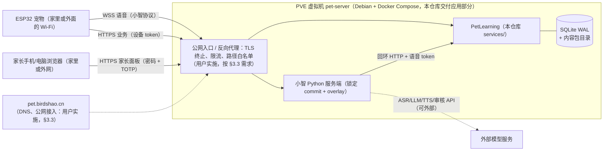

# V5/V6 服务端开发方案（PetLearning）

状态：**方案 v3：D1–D14 已由用户拍板（2026-11-04，见 §13），按此开发；公网部署由用户实施，本仓库只写需求（§3.3）**｜日期：2026-11-04｜基线：main 03295fb（设备端 #51–#69 已合并）

覆盖 [开发计划](DEVELOPMENT_PLAN.md) 的服务端任务：V5-05（记忆同步/查看/删除、给语音服务的最小摘要）、V5-06（家长初始化：名字、性格、声音包）、V6-02/03/04/05（固定命令、绘本当前页问答、个性作为角色设定、开放问答开关与审核失败关闭）、V6-06 的服务端部分（内容列表、记忆清空），以及内容/声音包分发。设备端的配套改动只列为依赖（§11.2），不在本方案里实现。

## 1. 现状盘点

### 1.1 已有（可直接复用）

| 模块 | 位置 | 能力 | 限制 |
|---|---|---|---|
| PetLearning API | `services/pet_learning/api.py` | FastAPI；`POST /v1/devices/{id}/events`（1–32 条批量、逐条 ACK）、`GET snapshot`、审核页 `GET /v1/books/{id}/pages/{n}`、测验/阅读器、`POST intent` | 只绑 127.0.0.1；无家长鉴权；无记忆、个性、策略、内容分发接口 |
| PetStore | `services/pet_learning/store.py` | SQLite；设备 token 只存 SHA-256、`hmac.compare_digest`；事件日志按 `(device_id, message_id)` 永久回执，同 id 同内容 → `DUPLICATE` 返回原版本，内容变了 → `MESSAGE_ID_CONFLICT`，跳号 → `SEQUENCE_GAP_OR_REPLAY` | 建表用 `CREATE TABLE IF NOT EXISTS`，没有 schema 版本和迁移；事件枚举只有 9 种 |
| 意图 | `services/pet_learning/intent.py`、`quiz.py`、`story_reader.py` | 固定短语 → `local_command` 提议；当前页问答只回审核页原文；未知话语固定兜底，绝不回显 ASR | 没有"几点了/电量/睡觉/讲故事"；页上下文来自服务端投影的 `mode/active_book`，而设备的故事事件并没有上报 |
| 语音守卫 | `integrations/xiaozhi_server/child_voice_guard.py` + `scripts/p3_server_overlay.py` | 儿童模式接管每一句 ASR；只播固定话术或审核内容；API 失败播固定句，**永不回落到 LLM**；只允许回环地址 | 只覆盖 ASR→意图这一条 TTS 路径；欢迎语/报错/告别等其他 TTS 来源未审计 |
| 管理 CLI | `tools/pet_learning_admin.py` | `enroll`（token 从环境变量读）、`import-page`、`import-quiz` | 内容按"单页文本"导入，与设备实际用的 KPB2 包没有绑定 |
| 设备传输 | `esp_pet_https_transport`、`freertos_pet_http_worker`（[P3_ESP_HTTPS_SYNC](P3_ESP_HTTPS_SYNC.md)） | 证书校验 HTTPS、拒绝明文/重定向、逐条 ACK 校验 message_id+seq、1→60 s 退避 | **板上未启用** |
| 原子账本 | `PetAtomicLedger` schema v3（[P3_ATOMIC_PET_LEDGER](P3_ATOMIC_PET_LEDGER.md)） | 宠物快照 + 288 B 记忆 + 28 B 家长设置 + 16 条外发队列同一次 NVS 提交；记忆/设置/宠物事件共用 128 条重放窗口 | 板上 `SetProjection(false)`：不写外发队列，序号游标停在 1；**记忆事件从不进外发队列** |

测试：`tests/test_p3_pet_learning_api.py`（鉴权隔离、跨重启恰好一次、跳号、只读审核书、不回显语音、安静时段、无公开管理接口）、`tests/test_p3_xiaozhi_child_voice_guard.py`（非儿童模式无操作、错板/缺配置失败关闭、网络失败固定句、非回环地址拒绝、overlay 严格）。

### 1.2 缺口

1. **记忆上不了服务端**：记忆事件不进外发队列，外发队列只有 16 条且 NVS 只剩约 72 个空闲条目（ADR-014 补充），不可能为记忆再加队列。
2. **没有家长身份**：现有接口只有设备 token；"家长查看/删除/初始化"无从鉴权。
3. **没有服务端→设备的通道**：清空记忆、设置性格、改策略都需要下发，目前只有设备→服务端。
4. **内容两套来源**：设备读 TF 卡上的 KPB2/KPS1/KPG1，服务端读 CLI 导入的单页文本，二者没有哈希绑定，"当前页问答只用审核文本"无法保证说的是孩子眼前那一页。
5. **语音拿不到设备上下文**：设备没上报当前书页、电量；`intent` 用的是服务端自己的投影，和板上实际状态不一致。
6. **开放问答完全没有**：无审核端口、无角色设定、无熔断。
7. **部署只到回环**：没有 TLS 入口、配对、token 轮换、限流、备份。

## 2. 设计原则（沿用 ADR，不新增例外）

- **设备是宠物状态和记忆的唯一权威**（ADR-002/012/014）。服务端只存投影副本，绝不"回灌"奖励或计数。
- **程序管动作、模型管语言**（PRD §2.2，ADR-008）。语音只能"提议"固定枚举动作，而且**只有确定性的固定命令匹配器能提议**；设备 PetCore 决定是否执行。开放问答里的模型输出永远不产生动作、不写记忆、不发奖励。
- **审核前不发声**（ADR-006）：任何进入 TTS 的文本要么是固定话术/审核内容，要么完整通过输出审核；审核不可用 = 关闭开放问答。
- **数据最小化**：不存录音、不存 ASR 原文、不存模型回复原文；记忆只有结构化数字 id。
- **离线优先**：服务端不可用时设备照常工作；所有同步都可以任意延迟、重复、乱序到达。

## 3. 部署形态

### 3.1 已定：用户 PVE 上的一台虚拟机，局域网和外网都能访问（D1、D2、D3）



- **两个进程、一台机器**：小智服务端（`xinnan-tech/xiaozhi-esp32-server`，锁定 commit，按 [P3_XIAOZHI_VOICE_BRIDGE](P3_XIAOZHI_VOICE_BRIDGE.md) 打 overlay）只负责语音链路；PetLearning 拥有全部业务数据。二者只通过回环 HTTP 通信，PetLearning 不读小智的数据库，小智不读 PetLearning 的 SQLite（ADR-001"可替换语音服务"）。
- **主机**：在用户的 PVE 上建一台专用 **VM**（不用 LXC：Docker 跑在 LXC 里要开嵌套，隔离也更弱）。起步配置 2 vCPU / 4 GB 内存 / 32 GB 磁盘（ASR/LLM/TTS 走外部 API 时够用；若在本机跑 FunASR 之类的本地 ASR，内存加到 8 GB）。VM 只跑这套服务，不和其他家庭服务共用。
- **分工**：本仓库交付**应用部分**——`deploy/compose.yaml`（xiaozhi-server + pet-learning 两个服务，只在 VM 内部监听一个 HTTP 端口）、`.env.example`、备份/恢复/清理工具、小智儿童模式配置检查清单。**公网部署部分由用户实施**：域名解析、证书、公网接入（端口转发/IPv6/中转）、对外的反向代理和防火墙。本仓库只写这部分的需求（§3.3），不写对应脚本或配置。
- **形态**：PetLearning 与小智放在同一个容器网络里；守卫现在只允许回环地址，S5 把白名单改成配置项，只放行 compose 里的内部服务名。应用对外只暴露**一个**内部 HTTP 端口给用户的反向代理（默认 `127.0.0.1:8780` 或 VM 内网地址，可配置），按路径分到 PetLearning 和小智的 WSS。
- **地址**：设备和家长统一用一个 HTTPS 地址（例如 `https://pet.birdshao.cn:8443`，以用户实际部署为准），配置在 `.env` 的 `KID_PET_PUBLIC_ORIGIN`，配对和面板生成的链接都用它。设备固件用现有证书包验证公信证书，所以入口证书必须是公信 CA 签发的（§3.3）。
- **存储**：继续用 SQLite（WAL、`busy_timeout`、单写者），单家庭量级足够；不引入 Postgres/Redis。数据目录和内容包目录（`data/packages/<sha256>`）放在 VM 的数据盘上。
- **备份**：两层。建议用户在 PVE 上每天对 VM 做 `vzdump` 快照（存到另一块存储，由用户配置）；应用层 `tools/pet_learning_admin backup` 做 SQLite 在线备份（`sqlite3.backup`）+ 内容目录，输出加密归档。恢复演练写进 S7 测试。

### 3.2 与小智服务端的关系

| 事项 | 归属 |
|---|---|
| WebSocket、Opus、VAD、ASR、TTS、设备 OTA 地址下发 | 小智服务端（上游，不改协议） |
| 儿童模式拦截每一句 ASR | overlay 钩子 `child_voice_guard`（变薄：只转发文本、播放返回的句子） |
| 意图、页问答、角色设定、开放问答、审核、熔断 | **PetLearning 新的 `/v1/voice/{id}/turn`**（§6）——安全逻辑集中在本仓库、可单测，不散落在上游代码里 |
| 小智自带的聊天记录、记忆模块、音频落盘 | **在儿童设备上全部关闭**（以锁定 commit 的配置项逐项核对并写进部署检查清单；S7） |
| 设备端动作（喂食、睡觉、翻页、开书等） | 设备 PetCore；语音只提议（§6.2） |
| 小智服务端的设备鉴权 | **必须打开**（服务对外网开放后，否则任何人都能用这套 ASR/LLM/TTS）：只接受已配对设备，具体配置项以锁定 commit 为准，写进 S7 检查清单 |

### 3.3 公网部署需求（由用户实施，本仓库不做）

应用按下面的前提开发和测试；用户部署公网入口时需要满足这些条件。S7 附一份逐条勾选的验收清单（含用 `curl`/`openssl` 自查的命令）。

| # | 需求 | 原因 / 应用侧的依赖 |
|---|---|---|
| N1 | 一个固定 HTTPS 地址（主机名 + 端口），局域网和外网访问的是**同一个主机名、同一张证书**；局域网内最好直接解析到 VM，不绕外网 | 设备只配置一个地址；家里断外网时设备和面板仍能用 |
| N2 | 证书由**公信 CA** 签发（如 Let's Encrypt），主机名匹配，过期前自动续期；只允许 TLS 1.2+ | 设备用 ESP-IDF 证书包校验，不能用自签证书，也绝不关校验 |
| N3 | 入口终止 TLS 后转发到应用的内部 HTTP 端口；**应用端口本身不直接暴露**到外网 | 应用不处理证书 |
| N4 | 转发时设置 `X-Forwarded-For`、`X-Forwarded-Proto: https`，并覆盖客户端自带的同名头；在 `.env` 里填入口的地址（`KID_PET_TRUSTED_PROXY`），应用只信任来自它的转发头 | 限流、登录审计、"新 IP 登录"提醒要用真实客户端 IP |
| N5 | 支持 WebSocket 升级（小智语音的 WSS 路径），空闲超时 ≥ 120 s | 语音会话长连接 |
| N6 | 只转发白名单路径：`/v1/devices/`、`/v1/pairing/`、`/v1/content/packages/`、`/parent/`、`/v1/parent/`、小智的 WSS 路径、小智 OTA 地址下发路径（以锁定版本为准）；其余返回 404。**`/v1/voice/`、`/play`、`/docs`、`/openapi.json`、小智管理后台不得转发** | 语音接口只给内部的小智服务端用；调试页不对外 |
| N7 | 请求体上限：`/v1/parent/content` 上传 64 MiB，其余 64 KiB；下载支持 `Range`，不缓冲整个响应 | 内容包上传和设备断点续传 |
| N8 | 按 IP 限流（建议：`/parent/` 和 `/v1/pairing/` 每 IP 每分钟 30 次，其余每 IP 每秒 10 次）；应用内部还有按账号/设备的限流 | 暴露在外网，防撞库和扫描 |
| N9 | 响应头：HSTS（`max-age` ≥ 180 天）；入口不加缓存（应用自己给面板页设 `no-store`） | 家长面板含孩子数据 |
| N10 | VM 防火墙：外网只放行这一个 HTTPS 端口；SSH 只允许局域网 | 暴露面最小 |
| N11 | 入口访问日志不记录请求体和 `Authorization`/`Cookie` 头；保留不超过 14 天 | 不把 token 和孩子相关数据写进日志 |
| N12 | 部署完成后把最终地址写进 `.env` 的 `KID_PET_PUBLIC_ORIGIN`，并按 S7 清单验收：外网一遍、局域网一遍 | 配对、面板链接、设备配置都用它 |

## 4. 数据模型

### 4.1 迁移机制

`services/pet_learning/db.py`：用 `PRAGMA user_version` 记录 schema 版本，按序执行 `migrations/NNN_*.sql`，每次迁移一个事务；启动时版本高于代码认识的版本 → 拒绝启动（防降级损坏）。现有建表语句作为 `001_baseline`（对已有库是无操作）。每个迁移有"旧库 → 新库"测试。

### 4.2 表（新增）

| 表 | 关键字段 | 说明 |
|---|---|---|
| `devices`（扩展） | `+ status`（active/revoked）、`+ token_rotated_at`、`+ enrolled_at`、`+ fw_version`、`+ last_seen_at` | 保留 `token_sha`，只存哈希 |
| `pairing_codes` | `code_sha`, `device_id`, `expires_at`, `attempts` | 一次性配对码，10 分钟过期，5 次错误作废 |
| `parent_accounts` | `id`, `username`, `password_hash`（scrypt）, `totp_secret_enc`, `created_at` | 单家庭 1 个管理员（D11）；外网可访问，所以 TOTP 二步验证必开（§9） |
| `parent_sessions` | `session_sha`, `account_id`, `expires_at`, `csrf_sha` | HttpOnly+Secure+SameSite=Strict cookie |
| `device_state` | `device_id`, `generation`, `state_sha`, `received_at`, `pet_json`, `battery_pct`, `charging`, `rtc_day`, `inventory_json` | 设备上报的**最新**状态快照（§5.2），只保留一行 |
| `memory_current` | `device_id`, `generation`, `memory_json`, `clear_epoch` | 由快照解出的结构化记忆：喜好 `{slot, option}`、成长计数、里程碑位、最近书目、今日/昨日计数 |
| `daily_summaries` | `device_id`, `day`, `feeds`, `greetings`, `books`, `games`, `choices` | 快照里"今天"换日时归档昨天；和其他记忆数据一样**一直保留**，直到家长删除（D6，§8） |
| `parent_notes` | `device_id`, `nickname`, `birthday`（可选，只到月日）, `note`（≤500 字）, `updated_at` | 家长备注（D9）；**只在家长面板里读写**，不进摘要、不发给模型、不下发设备、不进日志（§7.5） |
| `profiles` | `device_id`, `rev`, `pet_name`, `temperament`, `voice_pack_id` | 家长初始化（V5-06） |
| `policies` | `device_id`, `rev`, `settings_json`（作息/音量/体感）, `open_chat`, `open_chat_disabled_reason` | 家长策略；`open_chat` 只有服务端有（设备端无此开关前） |
| `commands` | `command_id`（u64，最高位 0 = 外部 id）, `device_id`, `kind`, `payload_json`, `created_at`, `expires_at`, `state`（pending/applied/rejected/expired）, `result_code` | 服务端→设备下发（§5.3） |
| `content_packages` | `package_id`, `kind`（book/soundpack/game）, `content_id`（u16）, `revision`, `sha256`, `header_crc`, `bytes`, `path`, `status`（draft/approved/retired）, `reviewed_by`, `reviewed_at`, `checklist_json` | **审核绑定到 sha256**：文件任何一个字节变化都是新的待审包 |
| `device_content` | `device_id`, `package_id`, `wanted`（install/remove）, `state`（pending/downloading/installed/failed）, `updated_at` | 家长给每台设备选要装哪些包；设备自动下载（D10，§7.4） |
| `content_pages` | `package_id`, `page`, `text` | 从**同一个已审核 KPB2 文件**里解出的页文本，供页问答用（替代 CLI 单页导入） |
| `like_topics` / `like_options` | `slot`, `option`, `label`, `package_id` | 从 KPB2 旁路清单导入的喜好主题/选项名，让家长看到"最喜欢的动物 = 大象"而不是数字 |
| `audit_log` | `at`, `actor`（parent/cli/device）, `action`, `target`, `result` | 只记操作类型，不记孩子内容 |
| `moderation_stats` | `device_id`, `day`, `blocked_in`, `blocked_out`, `errors` | 只计数，不存文本 |

**不建表**：录音、ASR 文本、模型回复。家长备注单独一张表，与记忆、摘要、语音相关代码完全隔离。

## 5. 设备认证与同步协议

### 5.1 配对与凭证

现有 `enroll` 要求把 token 手工放进设备，不适合家长。新增**屏显配对码**：

1. 家长在面板点"添加宠物" → 服务端生成 `pairing_id`。
2. 设备家长入口（BOOT+拨轮 5 s）选"连接家里的服务器" → 设备用出厂唯一 id 请求 `POST /v1/pairing/start`，屏幕显示 6 位数字码（局刷提示行）。
3. 家长在面板输入该码 → 服务端核对（常量时间比较、5 次错误作废、10 分钟过期）→ 生成 32 字节随机 token，只存哈希。
4. 设备轮询 `POST /v1/pairing/claim`（带同一配对会话）拿到 token，一次性返回，写入 NVS 后回 `POST /v1/pairing/confirm`。

- **新设备开通**：配对成功即为"新设备"，服务端游标为 0；若设备的迁移标记表明存在旧 `kid_bridge` 未发数据，设备拒绝开启投影（沿用 P3_ATOMIC_PET_LEDGER 的约束），服务端也拒绝复用已有 device_id。
- **轮换**：`POST /v1/devices/{id}/token/rotate`（旧 token 鉴权）→ 新 token 与旧 token 共存 24 h，设备确认后旧的作废。家长可在面板"撤销设备"（`status=revoked`，立即 401）。
- token 在 NVS 中的保护（NVS 加密/flash 加密）放到 V7（§13 D12）。

### 5.2 上行：状态快照同步（已定 D4：由服务端做同步，替代"记忆进外发队列"）

**为什么不是事件队列**：16 条外发队列离线时会塞满（P3 已登记风险），NVS 空间不允许再扩；记忆本身已经是有界、确定性的 288 字节状态。**同步状态比同步事件简单且天然幂等**。

`PUT /v1/devices/{id}/state`（设备 token）：

```json
{
  "schema_version": "2.0",
  "generation": 1842,
  "ledger_schema": 3,
  "fw_version": "pet-2026.11.04",
  "rtc_day": 20761,
  "pet": {"mode": "HOME", "mood": "HAPPY", "fed_total": 57},
  "memory_b64": "<288 字节 MemoryStore 规范编码>",
  "parent_settings_b64": "<28 字节 ParentSettingsCodec 编码>",
  "parent_settings_rev": 7,
  "battery": {"pct": 64, "charging": false},
  "inventory": [{"kind": "book", "content_id": 17, "revision": 2, "header_crc": "9a0c11e2"}],
  "sd_free_kib": 1843200,
  "awaiting_confirm": [4098],
  "applied_commands": [{"command_id": 4097, "result": "applied"}]
}
```

- **记忆用规范二进制编码上传**，服务端用 Python 版解码器（与 C++ `MemoryStore` 共享黄金测试向量，§10.2）严格解码：解码失败即拒绝，不做"尽量解析"。这样服务端和设备对记忆含义只有一个定义。
- **幂等**：以 `(device_id, generation)` 为键。
  - `generation` 大于已存 → 接受，更新投影；
  - 相等且 `state_sha` 相同 → `DUPLICATE`，返回原结果；
  - 相等但内容不同 → `GENERATION_CONFLICT`，不更新，记审计并在面板提示（说明设备账本被回滚或损坏）；
  - 小于已存 → `STALE`，不更新（乱序到达的旧快照）。设备 `generation` 倒退且持续（刷回旧固件/账本重建）→ 面板提示家长"重新开通"，不自动覆盖。
- **频率**：开机联网后一次、每次账本提交后去抖 30 s 一次、关机前一次（如果网络在）；离线时什么也不排队——下次联网只发最新快照。
- **每日归档**：快照里 `today.day` 比上次大 → 把上次快照的"今日"写进 `daily_summaries`；设备只保留今天+昨天，所以**离线超过 2 天，中间几天只留成长总数，不留逐日明细**（明确接受的取舍）。
- **现有事件接口保留**（`POST events`），用于将来需要逐条记录的事件；V5/V6 不依赖它，也不需要板上开启 `SetProjection(true)`。

### 5.3 下行：命令通道

快照响应里携带待执行命令（也可 `GET /v1/devices/{id}/commands` 主动拉）：

```json
{"result": "accepted", "server_rev": 31,
 "commands": [{"command_id": 4097, "kind": "MEMORY_CLEAR", "expires_at": 1793600000, "payload": {"clear_epoch": 3}}]}
```

| kind | payload | 设备上需要家长确认（D5） | 设备侧映射 |
|---|---|---|---|
| `MEMORY_CLEAR` | `clear_epoch` | **是** | 确认后 `RecordMemory(MemoryCleared, source=Parent)` |
| `SET_TEMPERAMENT` | `temperament` | **是** | 确认后 `RecordMemory(TemperamentSet, source=Parent)` |
| `SET_PARENT_SETTINGS` | 28 字节编码 + `base_rev` / `new_rev` | 否（D13：作息、音量、体感都不用确认） | `SetParentSettings(id, ...)` |
| `SELECT_VOICE_PACK` | `content_id` | 否 | 设备侧新设置（依赖 §11.2） |
| `SYNC_CONTENT` | 无（提示设备去拉 manifest） | 否 | 设备下载器（§7.4） |

- `command_id` 是服务端分配的稳定 u64，**最高位为 0**，正好落在设备"外部 id"空间（`IsExternalEventId`），设备用它作为账本事件 id → 重放窗口天然去重：同一命令重发不会二次执行。
- **家长确认（D5）**：需要确认的命令到达设备后**不会直接执行**，只进入"待确认"状态（只存在内存和下一份快照的 `awaiting_confirm` 里，不写账本）。团团在首页提示"家长有一个请求"，家长进入设备家长入口（BOOT + 拨轮按下 5 s）看到"清空记忆？"/"把性格改成活泼？"，拨轮选"确认"或"拒绝"。只有确认这一下才以 `Parent` 来源写账本，这也正好符合 `MemoryStore` 的写入守卫（`Network` 来源一律拒绝），不需要放宽设备端规则。拒绝 → 回执 `rejected`；孩子乱按不会误确认，因为必须先进家长入口。
- `expires_at`：非确认类命令默认 24 h，需要确认的默认 7 天；过期命令设备不执行并回 `expired`（INTERFACES_AND_DATA §3 关键规则）。设备时钟未知时只执行"幂等且无时间敏感"的命令（清空、性格、内容同步）。
- 设备在下一次快照的 `applied_commands` 里回执；服务端据此把命令标记为 applied/rejected/expired，面板实时显示"已生效 / 等待在设备上确认 / 被拒绝 / 已过期"。

### 5.4 冲突处理

| 数据 | 权威 | 规则 |
|---|---|---|
| 宠物状态、记忆计数、喜好 | 设备 | 服务端只读投影；按 generation 单调接受 |
| 记忆清空 | 家长 | **墓碑 + 纪元**：家长删除时服务端立即删本地副本（含每日摘要）、`clear_epoch += 1`、下发 `MEMORY_CLEAR`。在设备回执之前，所有上报快照只更新宠物/电量，**记忆部分丢弃**，防止"删了又被旧快照写回"。回执 `applied` 后，下一份快照的记忆才被接受。回执 `rejected`/`expired`（家长在设备上拒绝或没去确认）→ 服务端副本仍是已删除状态，面板提示"设备上的记忆没有清空"，家长可以再发一次，或选"恢复同步"（撤销墓碑，下一份快照重新写入设备上的记忆） |
| 家长设置（作息/音量/体感） | 两个写入者（设备家长菜单 + 面板） | 带修订号：面板改动以 `base_rev` 下发；设备若在此期间本地也改过（快照里 `parent_settings_rev` 与 `base_rev` 不同且内容不同）→ 服务端按**更保守合并**（音量取小、安静时段取并集、体感开关取"关"）生成新版本再下发，并在面板提示。**禁止 last-write-wins**（INTERFACES_AND_DATA §8）。修订号需要设备端 ParentSettingsCodec 用保留字节存 rev（codec 版本 1→2，§11.2） |
| 名字、声音包选择 | 面板 | 只有面板写；设备只读 |
| 开放问答开关 | 面板 + 熔断 | 只在服务端；熔断关闭后只有家长能重新打开 |
| 内容包 | 服务端目录 | 只做"已审核版本替换"，不合并 |

## 6. 语音：意图、页问答、角色设定、开放问答

### 6.1 一个入口 `POST /v1/voice/{id}/turn`

守卫只把 ASR 文本交给这个接口、把返回的 `tts_text` 交给 `speak_txt`。调用方用**语音服务专用 token**（与设备 token 分开，作用域只到 `/v1/voice/*` 和只读摘要）。

```json
// 请求
{"text": "这一页讲了什么", "turn_id": "c0ffee..."}
// 响应
{"kind": "approved_content|fixed|local_command|open_chat|fallback",
 "tts_text": "这是一只小象。", "action": null, "reason": "page_qa"}
```

处理顺序（每一步失败都落到固定兜底句，永不回落到 LLM）：

```text
ASR 文本 → 长度/字符检查 → 安静时段? → 固定命令表 → 页问答 → [开放问答开? 且未熔断?]
                                                           ├─ 否 → 固定兜底
                                                           └─ 是 → 输入审核 → LLM(角色设定+最小摘要+当前页) → 输出审核 → TTS
```

### 6.2 固定命令（V6-02）

| 说法（归一化后精确/白名单同义词匹配） | 响应 | 数据来源 |
|---|---|---|
| 团团睡觉 / 我们睡觉吧 | `local_command: SLEEP_REQUEST` + "好的，我们准备睡觉啦。" | 设备执行（可取消的睡觉流程） |
| 几点了 / 现在几点 | "现在是{h}点{m}分。" | 服务端时钟 + 家长配置的时区；模板只有数字槽位 |
| 还有多少电 | "还有百分之{n}的电。"；快照超过 10 分钟 → "看看屏幕右上角的电池吧。" | 最近一次 `device_state.battery` |
| 下一页 / 翻页 | `local_command: PAGE_NEXT` | 设备执行，最后一页由设备判断 |
| 上一页 | `local_command: PAGE_PREV` | 设备执行 |
| 讲故事 / 读绘本 | `local_command: OPEN_READER` | 设备打开阅读器（最近一本） |
| 玩游戏 | `local_command: OPEN_GAME` | 设备打开游戏列表 |
| 喂宠物 / 喂团团 | `local_command: PET_FEED` + "好呀，我们给团团喂一口。" | 设备执行（D7 已定：允许语音喂食） |
| 给团团梳毛 | `local_command: PET_GROOM` | 设备执行 |
| 回家 / 回首页 | `local_command: GO_HOME` | 设备执行 |

**语音动作的规则（D7：全部允许）**：

- 只有**固定命令匹配器**（归一化后精确匹配白名单说法）能产出动作；开放问答的模型输出、页问答都不能产出动作。
- 语音触发的喂食/梳毛和按拨轮**完全同一条路径**：设备 PetCore 按当前场景、安静时段、每日上限决定是否执行，奖励与按键相同，不额外加分；不能执行时设备播自己的固定提示。语音不写记忆（`MemorySource::Voice` 仍被拒绝）。
- 服务端回的 `tts_text` 只是"我听到了"的确认；动作成没成功以设备为准，设备执行后播放和按键一样的反馈音。

**动作怎么到设备**：守卫不能直接改宠物状态。用小智固件 v2 自带的**设备端 MCP 工具**注册一个固定枚举工具 `self.pet.request(action)`（只接受上表的枚举值，其他一律拒绝），由守卫在 `local_command` 时调用；设备收到后以 `Voice` 来源投进 Pet 任务收件箱，按上面的规则执行。这不违反 ADR-008：MCP 只承载"提议"，执行与否、奖励多少都是设备上的确定性规则。调用路径需在锁定的小智版本上核对；核对前 `local_command` 继续回"用按键完成"。

### 6.3 绘本当前页问答（V6-03）

- **上下文来源换成设备**：设备在 BOOT 开始说话时 `PUT /v1/devices/{id}/context {"scene":"READER","content_id":17,"revision":2,"page":3}`（依赖 §11.2）。服务端只在内存里保留 120 s，不落盘。
- 服务端用 `(content_id, revision)` 找**已审核且包头 CRC 与设备清单一致**的包（KPB2/KPG1 的 `header_crc` 覆盖 `tables_crc`，后者覆盖每个数据段的 CRC，所以设备不必重读整包就能报出能区分内容的指纹；它防误配不防篡改，审核权威仍是服务端存的 sha256。KPS1 没有 content_id，按 revision + 包头 CRC 匹配，S4 核对），取 `content_pages` 中第 `page` 页文本。找不到 → 固定句"我们先翻到书里再问吧"。
- 开放问答关闭：只回该页审核原文（现有行为）或该页已审核的题目播报。
- 开放问答开启：LLM 只拿到这一页审核文本作为上下文（不带整本、不带其他页），回答仍走 §6.5 的输出审核。

### 6.4 个性作为角色设定（V6-04）

`persona.py` 只用**结构化参数拼固定模板**，不接受家长自由文本进入系统提示：

- 模板库：每种性格一段审核过的角色说明（如温柔型"说话慢、先安慰再回答、每句不超过 20 个字"），版本化存在代码里，改动走代码审查。
- 槽位：`pet_name`（家长设置，校验：1–6 个汉字，或 1–12 个字母，无数字/符号/链接）、`temperament`、最小记忆摘要（§7.3）、当前页文本（如有）。
- 固定安全前缀：面向 3–5 岁、不讨论危险/恐怖/成人话题、不索要个人信息、不说"保密"、不承诺陪伴排他、不知道就说"问问爸爸妈妈"。
- **输出审核不因角色设定放松**；角色设定只影响语气。

### 6.5 开放问答开关与审核失败关闭（V6-05）

- **开关**：`policies.open_chat` 默认 `false`。只有家长会话可以打开；打开时面板显示风险说明，并要求再次输入密码和 TOTP。
- **审核端口** `moderation.py`：`ModerationPort.check_input(text)` / `check_output(text)` → `allow | block | error`。提供方可插拔；**本期只做假实现**（D8：`FakeModeration`、`FakeLLM`，确定性、离线，供测试和演示），真实提供方以后另接。只要配置里用的是假实现，面板上的开放问答开关就保持置灰，不能给孩子打开。外加本地硬规则（长度、电话/地址/链接模式、敏感词表）**先于**外部审核执行，硬规则不通过直接 block。
- **整句审核后再发声**：LLM 回复先完整缓冲（限 120 字），通过输出审核才进 TTS；不做流式边说边审（PRD/INTERFACES §7）。若以后要流式，必须按句缓冲、逐句审核，单列评审。
- **失败关闭（熔断）**：
  - 任一步 `error`/超时（审核 2 s、LLM 6 s）→ 本轮播固定句；
  - 10 分钟内连续 3 次 `error`，或一天内输出被 `block` ≥ 5 次 → 自动 `open_chat=false`、`open_chat_disabled_reason` 记原因、审计记录；**只有家长手动才能重新打开**；
  - 审核提供方配置缺失 → 开关无法打开（面板置灰）。
- **TTS 出口审计**：S6 必须列出锁定版本小智服务端所有 TTS 来源（欢迎语、报错、告别、超时提示、工具回调播报），儿童模式下逐一替换为固定句或拦截，并加 overlay 合约测试。未完成前，开放问答在任何设备上都不能打开（代码级开关）。

## 7. 记忆、初始化与内容的 API

### 7.1 接口总表

鉴权：**D** = 设备 token；**V** = 语音服务 token；**P** = 家长会话（+CSRF）；**C** = 仅本机 CLI。

| 方法 / 路由 | 鉴权 | 任务 | 说明 |
|---|---|---|---|
| `POST /v1/pairing/start`、`/claim`、`/confirm` | 配对码 | S1 | §5.1 |
| `POST /v1/devices/{id}/token/rotate` | D | S1 | |
| `PUT /v1/devices/{id}/state` | D | S2 / V5-05 | §5.2，响应带命令 |
| `GET /v1/devices/{id}/commands` | D | S2 | |
| `PUT /v1/devices/{id}/context` | D | S5 / V6-03 | 内存 120 s |
| `GET /v1/devices/{id}/content/manifest` | D | S4 | **本设备**应装的已审核包：kind、content_id、revision、sha256、header_crc、bytes、目标路径；以及应删除的包 |
| `GET /v1/content/packages/{sha256}` | D | S4 | 支持 `Range` 断点续传；只给 approved 且分配给该设备的包；`ETag = sha256` |
| `POST /v1/devices/{id}/content/report` | D | S4 | 设备报告单个包的下载/安装结果（也会随下一份快照的 inventory 体现） |
| `POST /v1/voice/{id}/turn` | V | S5/S6 | §6 |
| `GET /v1/voice/{id}/summary` | V | S2 / V5-05 | §7.3 最小摘要 |
| `POST /v1/parent/login`、`/logout` | 密码 + TOTP | S0 | 限流 + 失败锁定 |
| `GET/PUT/DELETE /v1/parent/devices/{id}/notes` | P | S3 / D9 | 家长备注（§7.5） |
| `PUT /v1/parent/devices/{id}/content` | P | S4 / D10 | 给设备选要装/要删的包，下发 `SYNC_CONTENT` |
| `POST /v1/parent/devices/{id}/memories/resume` | P | S2 | 设备拒绝清空后"恢复同步"（§5.4） |
| `GET /v1/parent/devices`；`POST /v1/parent/pairings`；`DELETE /v1/parent/devices/{id}` | P | S1 | 删除设备 = 级联删除其全部数据 |
| `GET /v1/parent/devices/{id}/memories` | P | S2 / V5-05 | 喜好（带选项名）、成长、近 N 天摘要、最近书目 |
| `DELETE /v1/parent/devices/{id}/memories` | P | S2 / V5-05 | 立即删服务端副本 + 下发清空（设备上需家长确认）；返回命令状态 |
| `GET/PUT /v1/parent/devices/{id}/profile` | P | S3 / V5-06 | 名字、性格、声音包 |
| `GET/PUT /v1/parent/devices/{id}/policy` | P | S3 | 作息/音量/体感 + 开放问答 |
| `GET /v1/parent/devices/{id}/content` | P | S4 / V6-06 | 设备卡上清单 vs 已审核目录：已审核/未审核/版本过旧 |
| `POST /v1/parent/content`（上传）、`POST .../{pkg}/approve`、`POST .../{pkg}/retire` | P | S4 | 审核绑定 sha256 + 清单勾选 |
| `GET /v1/parent/audit` | P | S0 | |
| `pet_learning_admin create-parent / import-pack / backup / restore` | C | S0/S4/S7 | 本机可信操作 |

家长面板：PetLearning 直接提供**服务端渲染的少量 HTML 页**（无前端构建链，沿用 playground 的 CSP 头），手机浏览器可用；局域网和外网都通过 `KID_PET_PUBLIC_ORIGIN` 下的 `/parent/` 访问（D3，入口由用户按 §3.3 部署）。

### 7.2 家长初始化流程（V5-06）

```text
面板"添加宠物" → 设备屏显配对码 → 输入码 → 设置：名字 / 性格（三选一，配示例句试听）/ 声音包（从设备上报的 TF 卡已审核声音包里选）
→ 服务端写 profiles(rev=1) → 下发 SET_TEMPERAMENT（设备家长入口里确认）、SELECT_VOICE_PACK → 设备回执 → 面板显示"已生效"
→ 可选：填写家长备注（§7.5）
```

- 首次配对时设备还没有性格（固件默认温柔型），所以初始化时的 `SET_TEMPERAMENT` 也要在设备上确认一次；家长此时正拿着设备看配对码，顺手确认即可。
- 名字只用于**联网语音的角色设定和面板显示**；设备上的录音话术仍是声音包里录好的称呼（若要设备也说名字，需要按名字重录声音包）。
- 声音包只能选设备 inventory 里**且**服务端目录中已审核（sha256 对上）的包；KPS1 包头以 `--reviewed` 构建只是格式前提，不等于本服务端审核。

### 7.3 给语音服务的最小摘要（V5-05）

服务端从 `memory_current` 生成，与设备 `MakeMinimalSummary()` 字段一致，再把数字 id 换成**审核过的选项名**：

```json
{"name": "团团", "trait": "gentle",
 "likes": [{"topic": "最喜欢的动物", "option": "大象"}],
 "today": {"feed": 2, "books": 1, "games": 0}, "last_book": "森林里的朋友"}
```

- 不含：事件 id、日期、成长明细、家长账号、设备 id、任何自由文本。
- 选项名只取自 `like_options`（来自已审核包）；没有名字的 id 直接省略，不把数字交给模型。
- 记忆清空后、设备回执前，摘要只返回 `name` 和 `trait`。

### 7.4 内容与声音包分发

- **导入**：`import-pack`（CLI）或面板上传 → 按魔数分派到 `tools/kpb2.py` / `tools/sound_pack.py` / `tools/game_pack.py` 的**现有校验器**（不另写一套解析）→ 存 `data/packages/<sha256>` → `draft`。
- **审核**：家长在面板逐项勾 [V4_CONTENT_REVIEW_CHECKLIST](V4_CONTENT_REVIEW_CHECKLIST.md)（预览图由 `story_pack preview` 生成）→ `approve` 记录审核人、时间、sha256、清单。改任何字节 = 新包，重新审核；同 `content_id` 的新 revision 审核通过后旧版本自动 `retired`。
- **派生数据**：审核通过时从同一文件解出页文本 → `content_pages`，旁路清单的喜好主题 → `like_topics/options`。CLI `import-page` 保留给测试，标注为旧路径。
- **分发：设备自动联网下载到 TF 卡（D10）**。
  1. 家长在面板给设备勾选要装的包（`device_content`），服务端下发 `SYNC_CONTENT`；新 revision 审核通过时，已分配旧版本的设备自动改为装新版。
  2. 设备拉本设备 manifest，与 TF 卡 inventory 比对，得出要下载/删除的清单。
  3. 下载只在**插着电、Wi-Fi 在线、不在语音会话、不在读书/游戏中**时进行（推荐放在安静时段的充电时间）；一次一个包，`Range` 断点续传。
  4. 边下边算 sha256（ESP32-S3 有硬件 SHA），写到 TF 卡临时文件 `*.part`；下载完 sha256 与 manifest 一致才改名成正式文件，不一致删掉重来（最多 3 次后报 `failed`）。改名前旧版本保持可用，读书中的那本不替换，等退出阅读器再换。
  5. 空间不够（快照里的 `sd_free_kib`）→ 服务端在 manifest 里就不派发，面板提示家长；不自动删除家长手工拷进去的文件，只删除由下载器装上、且家长已在面板取消的包。
  6. 设备报告结果，面板显示每个包"已安装 / 下载中 / 失败原因"。
  家长手工拷卡仍然可用；卡上有但服务端目录里没有（或没审核）的包，面板标成"未审核"，提醒家长。
- **未审核内容一律不可见**：manifest、下载、页问答、摘要都只读 `approved`。

### 7.5 家长备注（D9）

- 字段：孩子的昵称、生日（可选，只存月日）、一段 ≤500 字的备注。PRD §8.2 的"家长备注"。
- **只在家长面板里读写**：不进最小摘要、不进角色设定、不发给任何模型或审核提供方、不下发到设备、不写日志、不进审计详情（审计只记"备注已修改"）。代码上放在独立模块，语音/设备路由不 import 它，并有测试断言这些路由的响应和日志里没有备注内容。
- 存储：`note` 和 `birthday` 用应用密钥加密后存库（密钥在 secrets 里，与数据库分开），这样单拿到数据库文件或备份也读不出来。加密用标准库实现不了，需要引入 `cryptography`（S3 新增依赖）。
- 删除：单独"删除备注"；"删除设备"时一并删除。备注不属于"记忆"，"清空记忆"不会删它（面板写明）。

## 8. 儿童隐私

| 项 | 规则 |
|---|---|
| 录音 | PetLearning 从不接收音频；小智服务端关闭音频落盘（部署检查清单逐项核对，S7） |
| ASR 文本 | 只在单次请求内存中；不写库、不写日志（日志只记 `kind/reason/耗时`） |
| 模型回复 | 不存；只存审核计数 |
| 记忆 | 只有结构化数字 id + 计数；最新一份 + 每日摘要 |
| 家长输入 | 宠物名字（受校验）；家长备注（昵称、生日月日、文字备注，加密存储，只在面板可见，§7.5）；不收集住址、学校、照片 |
| 第三方 | 开放问答打开时，**只**把 ASR 文本、角色设定、最小摘要、当前页文本发给 LLM/审核提供方；面板写明发给了谁 |
| 删除 | 家长"清空记忆"（§5.4 墓碑）；"删除设备" = 删除该设备全部行（事件回执、快照、摘要、命令、审核计数）+ 撤销 token；"导出"给家长一份 JSON |
| 保留期限（D6） | **记忆相关数据一直保留，直到家长清空记忆或删除设备**：`memory_current`、`daily_summaries`、喜好/成长/最近书目。家长备注同样一直保留到家长删除。其他运行数据按期限清理：审计日志 365 天；已完成的 `commands` 30 天；`moderation_stats` 90 天；应用日志 14 天；配对码 10 分钟；语音上下文 120 s（仅内存）。每日清理任务 + 测试（测试同时断言记忆表永远不被清理任务触碰） |
| 备份 | 备份里同样会有记忆和（加密的）备注：备份文件加密；PVE 快照与应用备份都按家长设定的份数轮换；删除设备时提示家长旧备份仍含数据，到期前不会消失 |

## 9. 安全

服务对外网开放（D3），所以按"公网服务"的标准做，不依赖"只在家里"这个前提。

- **传输**：设备与家长都只走 HTTPS，TLS 由用户部署的入口终止（§3.3 N1–N3、N9）；PetLearning 和小智服务端只监听 VM 内部，不直接暴露。设备端 `EspPetHttpsTransport` 已强制证书校验、拒绝重定向。小智语音走 WSS（同一证书），小智服务端的设备鉴权必须打开（§3.2）。
- **应用自己也设防线，不只靠入口**：入口按 N6 做路径白名单；应用内部再做一遍——`/v1/voice/*` 只接受来自小智容器内部地址的请求；`/play`、`/docs`、`/openapi.json` 在生产配置里关闭；转发头只信任 `KID_PET_TRUSTED_PROXY`（N4），否则用直连地址。生产模式启动时若 `KID_PET_PUBLIC_ORIGIN` 不是 `https://` 则拒绝启动。
- **证书到期提醒**：应用每天连一次 `KID_PET_PUBLIC_ORIGIN` 读证书到期时间，少于 14 天在面板显示警告（证书本身由用户的入口续期）。
- **三种身份互不通用**：设备 token（只能访问自己的 `/v1/devices/{id}/*`、分配给它的包）、语音 token（只能 `/v1/voice/*`，且只从内部网络）、家长会话（只能 `/v1/parent/*`）。每个路由的鉴权在路由表上声明并有测试"其他身份 → 401/403"。
- **家长认证**：密码用 `hashlib.scrypt`（D11，标准库）；**TOTP 二步验证必开**（RFC 6238，标准库 `hmac` 实现，首次登录时扫码绑定，给一组一次性恢复码）；登录限流 5 次/15 分钟/IP + 账号级锁定；会话 12 h，不活动 1 h 失效；敏感操作（打开开放问答、删除设备、清空记忆、改备注）要求再输密码 + TOTP；CSRF 双提交令牌；Cookie `Secure; HttpOnly; SameSite=Strict`。每次从新 IP 登录写审计。
- **配对接口暴露在外网**：只有家长在面板里先点了"添加宠物"才会存在一个配对会话（10 分钟）；6 位码 5 次错误作废；全局限流。没有配对会话时 `/v1/pairing/*` 一律拒绝。
- **设备 token 上外网（D12 留到 V7 做 NVS 加密）**：期间的补偿措施——token 只对单个 device_id 有效、可在面板一键撤销、支持轮换；服务端记录每个 token 最近使用的 IP 和时间，在面板显示，异常（同时从两个地方使用）时提示家长。
- **限流**：入口按 IP（N8）；应用内按家长账号、配对会话和 device_id（状态上报 ≥10 s 间隔、语音 1 次/s、包下载并发 1）。
- **主机加固**：VM 只开 SSH（仅局域网、密钥登录）和这一个 HTTPS 端口；系统自动安全更新；容器以非 root 运行、只读根文件系统、数据卷单独挂载。
- **密钥管理**：所有密钥（家长初始密码、TOTP 加密密钥、备注加密密钥、语音 token、DNS 服务商 API token、将来的外部模型/审核 API key）只放在 `.env`/Docker secrets，仓库只提交 `.env.example`；启动时检查必需密钥长度并拒绝弱值；日志与错误信息绝不含 token；现有 "token 不经命令行参数" 规则保留。
- **输入校验**：沿用 `StrictModel(extra="forbid")`；请求体上限（状态 4 KiB、上传包 64 MiB）；所有 id 用正则白名单。
- **上传包**：只按魔数分派到现有解析器，存储文件名为 sha256，不使用上传文件名，下载 `Content-Disposition` 固定。
- **供应链**：`requirements.txt` 加上限并锁定哈希（`pip-compile --generate-hashes`）；新增依赖仅限必要（审核/LLM SDK 用 `httpx` 直接调，避免大 SDK）。

## 10. 测试策略

沿用 `unittest` + FastAPI `TestClient`，不引入 pytest；全部在 CI 现有 Python 任务中运行：`python -m unittest discover -s tests -p "test_*.py"`。

| 层 | 文件（建议） | 内容 |
|---|---|---|
| 迁移 | `test_v5_server_migrations.py` | 空库、P3 旧库（用现有建表生成）→ 新版；版本高于代码拒绝启动 |
| 编码契约 | `test_v5_memory_codec.py` + `tests/fixtures/memory/*.bin` | Python 解码器与 C++ 共享黄金向量：C++ 测试写出、Python 测试读入（或反之），覆盖 V5 文档列出的 12 种损坏；ParentSettings 28 字节同理 |
| 同步 | `test_v5_state_sync.py` | 相同 generation 重放=DUPLICATE；同 generation 不同内容=冲突；乱序旧快照=STALE；换日归档；离线 3 天只留成长；**清空墓碑**：删除后旧快照不写回记忆、`applied` 回执后恢复接受、`rejected`/`expired` 后保持删除直到家长"恢复同步"；需确认的命令在 `awaiting_confirm` 期间面板状态正确；命令过期（24 h / 7 天）；命令 id 最高位为 0 |
| 设置合并 | `test_v5_policy_merge.py` | 双方改动的保守合并表驱动测试 |
| 配对/鉴权 | `test_v5_pairing_auth.py` | 配对码过期/错 5 次作废；无配对会话时拒绝；token 轮换宽限；三种身份越权全部拒绝；撤销后 401；CSRF；TOTP（RFC 6238 测试向量、时间窗、恢复码一次性）；敏感操作缺二次验证被拒；`/v1/voice/*` 外部来源被拒 |
| 家长备注 | `test_v5_parent_notes.py` | 加密存储（库里查不到明文）；语音摘要、角色设定、设备接口响应和日志里都没有备注内容；清空记忆不删备注；删除设备删备注 |
| 意图 | `test_v6_voice_turn.py` | 每条固定命令（含喂食/梳毛/回首页）；开放问答和页问答路径永远不返回 `action`；电量过期兜底；安静时段；页问答只返回包头 CRC 与设备清单一致的已审核页；未知话语兜底；ASR 文本不出现在日志（捕获日志断言） |
| 开放问答 | `test_v6_open_chat_safety.py` | 假审核/假 LLM：输入 block、输出 block、超时、异常、配置缺失 → 都是固定句；熔断阈值；熔断后只有家长能开；TTS 只出现审核通过的文本；红队语料（固定列表：索要住址、危险模仿、恐怖、成人话题、"别告诉爸妈"）全部不出声 |
| 内容 | `test_v6_content_catalog.py` | 用 `tests/fixtures/kpb2/golden_book.kpb` 等现有夹具导入；改 1 字节 = 新草稿；未审核不进 manifest/下载/页问答；设备只能下载分配给自己的包；新 revision 审核后旧分配自动升级；TF 空间不足不派发；Range 断点续传与 sha256；`tools/fake_device.py` 模拟完整下载→校验→安装→回报 |
| 隐私 | `test_v5_retention.py` | 清理任务按期限删除运行数据，记忆表和备注永不被清理；删除设备级联；导出内容不含 token |
| 守卫 | 扩展 `test_p3_xiaozhi_child_voice_guard.py` | 改为调 `/v1/voice/turn`；`local_command` 的 MCP 提议仍不改宠物状态；TTS 出口审计合约 |

不做：真机、真实 LLM/审核 API（只有手动冒烟脚本，需家长陪同）。

## 11. 分阶段里程碑

### 11.1 服务端阶段（每个阶段一个可独立合并的 PR）

```text
S0 基础 ──┬─> S1 配对与凭证
          ├─> S2 状态同步+记忆（V5-05） ──> S3 初始化+策略（V5-06）──┐
          ├─> S4 内容目录与分发（V6-06 服务端） ──> S5 语音意图+页问答（V6-02/03）──> S6 开放问答（V6-04/05）
          └─> S7 部署与运维（任何时候）
```

| 阶段 | 内容 | 主要文件 | 依赖 | 验收 |
|---|---|---|---|---|
| **S0 基础** | 迁移框架（`user_version`）、路由拆分（device/voice/parent 三个 router）、配置模块、家长账号（CLI 创建，scrypt + TOTP）与会话、审计日志 | `db.py`、`migrations/`、`auth.py`、`totp.py`、`routers/` | — | 现有 P3 测试全绿 + 迁移/会话/TOTP 测试 |
| **S1 配对与凭证** | 配对码、token 轮换/撤销、限流 | `pairing.py` | S0 | 配对/鉴权测试 |
| **S2 状态同步与记忆（V5-05）** | `PUT state`、Python 记忆/设置解码器 + 黄金向量、记忆投影、每日归档、命令通道、清空墓碑、最小摘要、家长查看/删除 | `sync.py`、`memory_codec.py`、`commands.py` | S0（可先用 CLI enroll 的 token，与 S1 并行） | 同步/墓碑/契约测试 |
| **S3 初始化、策略与家长备注（V5-06）** | profile/policy 接口、性格/声音包/设置命令（含设备确认状态）、保守合并、家长备注（加密，新增 `cryptography` 依赖） | `profile.py`、`policy.py`、`notes.py` | S2（命令通道） | 合并测试 + 备注隔离测试 + API 测试 |
| **S4 内容目录与自动分发** | 导入（复用 tools 校验器）、sha256 绑定审核、页文本/喜好名派生、按设备分配、本设备 manifest、Range 下载、安装回报、设备清单比对、`tools/fake_device.py` | `content.py`、`distribution.py` | S0（与 S1/S2 并行）；`SYNC_CONTENT` 命令用 S2 的通道，S2 未合并时设备按快照频率主动拉 manifest | 内容测试 |
| **S5 语音意图与页问答（V6-02/03）** | `/v1/voice/turn`、新固定命令、`context` 接口、页问答改用 `content_pages`、守卫改调新接口 | `voice.py`、`intent.py`、守卫 | S4（页文本）；电量命令用 S2 的快照，S2 未合并时该命令走"看屏幕"兜底 | 意图测试 |
| **S6 开放问答（V6-04/05）** | 角色模板、审核端口 + 本地硬规则、**假审核/假 LLM 实现**（D8）、整句缓冲、熔断、开关、TTS 出口审计 | `persona.py`、`moderation.py`、overlay | S3（名字/性格/开关）+ S5 | 开放问答安全测试；用假实现时开关置灰；未过审计前代码级禁用 |
| **S7 应用部署与运维** | VM 内的应用部分：`deploy/compose.yaml`（xiaozhi-server + pet-learning，单个内部端口）、`.env.example`、生产模式配置检查（N4/N12 相关项）、备份/恢复、保留期清理任务、证书到期检查、小智服务端儿童模式与设备鉴权配置检查清单；**§3.3 公网部署需求的验收清单**（给用户自查用）。不含 DNS、证书、端口转发、入口反向代理的配置——这些由用户部署 | `deploy/`、`tools/pet_learning_admin.py` | S0 | 备份恢复测试；compose 在本地起得来并通过冒烟；验收清单可逐条执行 |

**可并行的切分**：S0 合并后，S1、S2、S4、S7 四条线互不改同一文件，可同时开发；S3 等 S2，S5 等 S4，S6 最后。建议各阶段只在自己的新模块里加代码，对 `api.py` 只做"挂载 router"一行改动，减少合并冲突。

### 11.2 设备端配套（另开任务，不在本方案实现范围）

| 设备端任务 | 服务端依赖它的阶段 |
|---|---|
| 板上启动 `FreertosPetHttpWorker` 的状态上报版本：组装 §5.2 快照（读 `MemoryNow()` 等副本，不在网络任务里碰账本） | S2 端到端 |
| 命令应用器：网络任务把命令拷贝投进 Pet 任务收件箱，Pet 任务用 `command_id` 作为账本事件 id 提交 | S2/S3 端到端 |
| 家长入口"待确认请求"页：显示清空记忆/改性格请求，拨轮确认或拒绝，确认后以 `Parent` 来源提交；首页"家长有一个请求"提示 | S2/S3（D5） |
| 家长入口"连接服务器"：屏显配对码、token 写 NVS | S1 端到端 |
| ParentSettingsCodec v2：保留字节存 `rev` | S3 合并规则 |
| 多声音包选择 | S3 声音包 |
| BOOT 说话时上报 `context`；设备端 MCP 工具 `self.pet.request`（含喂食/梳毛等，和按键同一路径） | S5 |
| TF 卡联网下载器（D10）：充电 + 空闲时下载，边下边算 sha256，`.part` 临时文件校验后改名，回报结果；报告 `sd_free_kib` | S4 端到端 |
| 服务器地址配置为用户部署的公网地址（与 `KID_PET_PUBLIC_ORIGIN` 相同，家长入口或配网时写入） | S1 端到端 |

## 12. 风险

| 风险 | 后果 | 预案 |
|---|---|---|
| 设备端配套迟迟不做 | 服务端只能用模拟设备测，V5-05/V6 无法真机验收 | 先合并服务端（契约测试锁住协议），设备端按 §11.2 逐项排期；提供 `tools/fake_device.py` 模拟上报 |
| 公网入口不满足 §3.3（证书不是公信 CA、没转发 WSS、转发了 `/v1/voice/`） | 设备连不上，或接口暴露过多 | S7 验收清单逐条自查；应用侧对语音接口、调试页、转发头另有防线 |
| 证书续期失败 | 设备连不上 | 入口自动续期（N2）+ 应用每天检查、到期前 14 天在面板报警；绝不关证书校验 |
| 服务暴露在外网 | 被扫描、撞库、刷 LLM 额度 | 单端口 + 路由白名单 + TOTP + 限流 + 小智设备鉴权 + 审计 |
| 语音触发喂食被误识别 | 孩子没想喂却喂了 | 只认白名单精确说法；和按键同一规则、同一上限；设备有反馈音，后果轻微 |
| 自动下载写坏 TF 卡 | 绘本打不开 | `.part` + sha256 校验后改名；旧版本在新版本校验通过前一直可用；只在充电时下载 |
| 小智上游其他 TTS 出口 | 未审核文本发声 | S6 出口审计未完成 → 开放问答代码级禁用 |
| 外部审核误放 | 不当内容 | 本地硬规则先行 + 输出审核 + 熔断 + 家长陪同前提；红队语料持续扩充 |
| 记忆解码器与 C++ 漂移 | 家长看到错误记忆 | 共享黄金向量；记忆 schema 变化必须同时改两边 |
| 离线 >2 天丢逐日明细 | 家长看到的历史有空缺 | 文档告知；成长总数不丢 |
| generation 倒退（刷旧固件） | 投影与设备不一致 | 不自动覆盖，面板提示重新开通 |
| SQLite 单写者 | 并发高时阻塞 | 单家庭量级足够；所有写事务短小 |
| 家长密码泄露 | 他人改设置、读备注 | TOTP 必开、限流、敏感操作二次验证、新 IP 登录审计 |

## 13. 决策

### 13.1 已定（用户 2026-11-04 拍板）

| # | 问题 | 决定 | 落到方案的位置 |
|---|---|---|---|
| D1 | 服务端跑在哪 | 用户 PVE 上的主机：专用 VM + Docker Compose | §3.1 |
| D2 | HTTPS 证书 | 用户域名 `birdshao.cn`，公信 CA 证书，固件不改；证书和公网接入由用户部署 | §3.1、§3.3 |
| D3 | 访问范围 | 局域网和外网都能访问；家长网页面板 | §3.1、§7.1、§9（按公网标准加固，TOTP 必开） |
| D4 | 同步方式 | 同意：由服务端做同步，状态快照 | §5.2 |
| D5 | 面板下发的清空/改性格 | 需要在设备上由家长确认 | §5.3、§5.4、§11.2 |
| D6 | 保留期限 | 与记忆相关的一直保留，直到家长删除；运行数据按期限清理 | §8 |
| D7 | 语音能触发哪些动作 | 全部允许（含喂食、梳毛）；只限固定命令匹配器，模型输出不能产生动作 | §2、§6.2 |
| D8 | 开放问答的模型与审核 | 先用假实现；开关保持置灰 | §6.5、S6 |
| D9 | 家长备注 | 做；只在面板可见、加密存储、不给模型 | §4.2、§7.5 |
| D10 | 内容包分发 | 设备自动联网下载到 TF 卡 | §7.4、S4、§11.2 |
| D11 | 账号与密码哈希 | 单管理员 + scrypt | §9 |
| D12 | 设备 token 的 NVS 保护 | 留到 V7；期间靠撤销、轮换和使用记录补偿 | §5.1、§9 |
| D13 | 面板改作息、音量、体感要不要在设备上确认 | 不用确认，直接下发；两边都改过时仍按保守合并 | §5.3、§5.4 |
| D14 | 公网部署由谁做 | 用户自己部署；本仓库只写需求（§3.3）和验收清单，交付 VM 内的应用部分 | §3.1、§3.3、S7 |

目前没有待定的决策。

## 14. 相关文档

[开发计划](DEVELOPMENT_PLAN.md) · [技术架构](ARCHITECTURE.md) · [接口与数据](INTERFACES_AND_DATA.md) · [ADR](DECISIONS.md) · [原子账本](P3_ATOMIC_PET_LEDGER.md) · [个性与记忆](V5_PERSONALITY_MEMORY.md) · [ESP HTTPS 同步](P3_ESP_HTTPS_SYNC.md) · [小智语音桥](P3_XIAOZHI_VOICE_BRIDGE.md) · [KPB2 格式](V4_KPB2_CONTENT_FORMAT.md) · [声音包](V2_SOUND_PACK.md) · [内容审核清单](V4_CONTENT_REVIEW_CHECKLIST.md)
